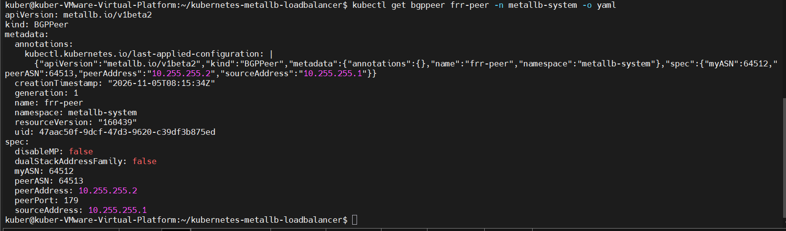
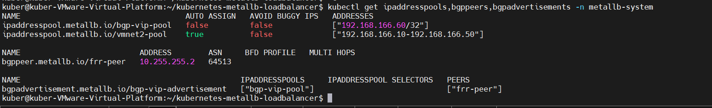
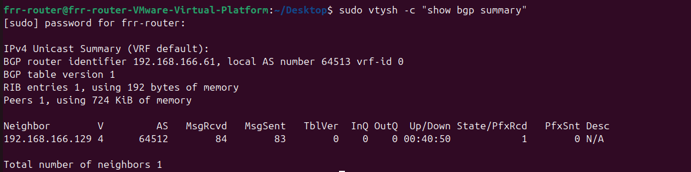
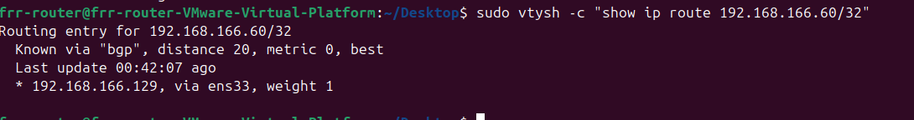
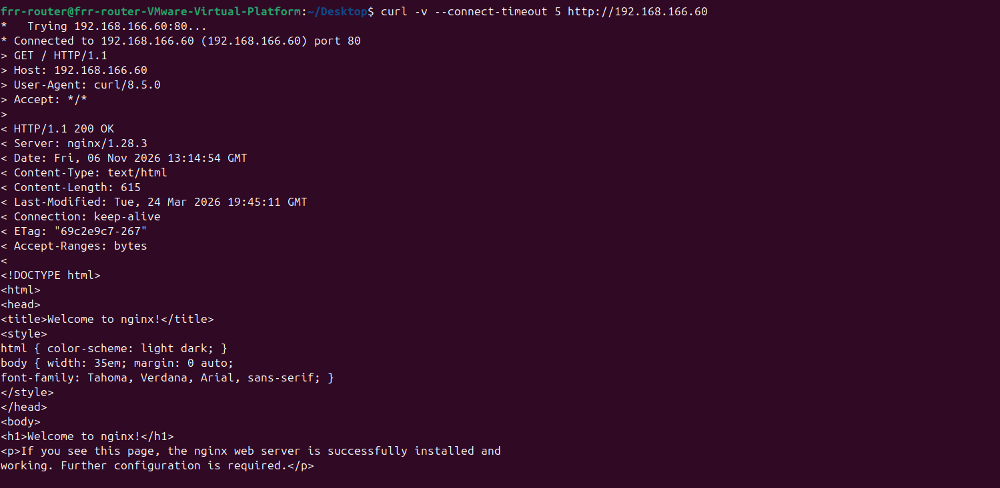
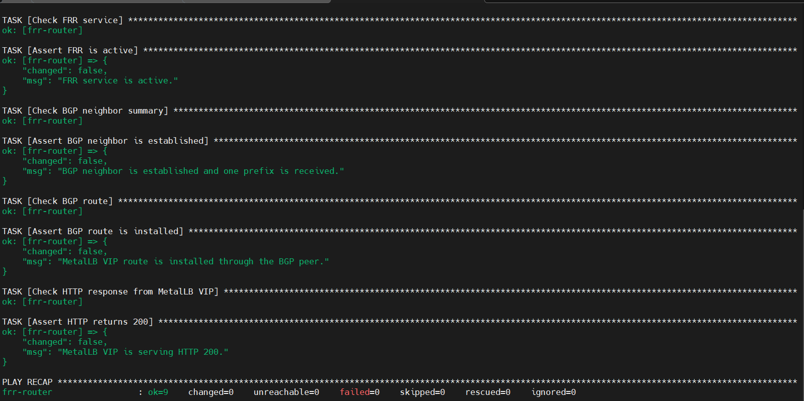
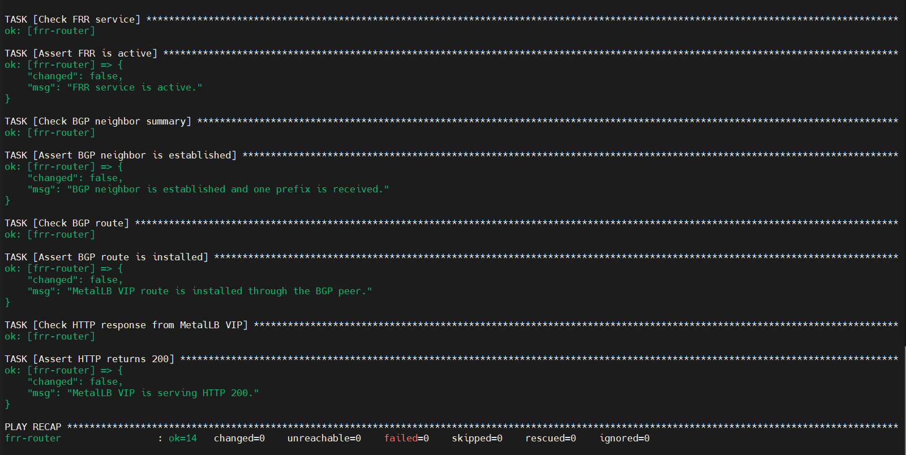

# Kubernetes LoadBalancer with MetalLB (Layer 2 and BGP)

A hands-on Kubernetes networking project demonstrating how to expose applications outside a self-managed Kubernetes cluster using MetalLB in Layer 2 and BGP modes.

The project was implemented using VMware virtual machines running Ubuntu Linux. It covers MetalLB installation, external IP advertisement, BGP peering with an independent FRRouting (FRR) router, failure recovery, and Ansible-based automation.

## 1. Project Overview

In bare-metal and self-managed Kubernetes environments, `LoadBalancer` Services do not automatically receive external IP addresses from a cloud provider.

MetalLB solves this problem by providing network load-balancing functionality for Kubernetes clusters running outside supported cloud environments.

This project was developed in several phases:

- Implementation of MetalLB Layer 2 mode.
- Deployment of Nginx using Kubernetes Deployments and Services.
- Validation of external connectivity and traffic distribution.
- Testing Kubernetes self-healing and node outage recovery.
- Implementation of BGP peering with an independent FRR router.
- Validation of BGP route advertisement, withdrawal, and recovery.
- Configuration of persistent FRR service operation.
- Implementation of Ansible automation for FRR service management and health verification.

## 2. Technologies and Environment

| Component | Technology / Version |
|---|---|
| Host operating system | Windows |
| Virtualization | VMware Workstation |
| Kubernetes operating system | Ubuntu 24.04 |
| Kubernetes | v1.37.0 |
| Container runtime | containerd 2.2.1 |
| CNI | Flannel |
| Load balancer | MetalLB v0.15.2 |
| BGP routing | FRRouting 8.4.4 |
| Configuration management | Ansible |
| Application | Nginx |
| Container registry | Nexus Repository |

## 3. Architecture

The project implements two MetalLB advertisement modes: Layer 2 and BGP.

### 3.1 Layer 2 Network Topology

The initial implementation uses a single Kubernetes node connected to a VMware Host-only network.

| Component | Configuration |
|---|---|
| Kubernetes node | 192.168.166.129 |
| Kubernetes interface | ens37 |
| Network | VMware VMnet2 |
| MetalLB address pool | 192.168.166.10–192.168.166.50 |
| Assigned external IP | 192.168.166.10 |
| Nginx Service | nginx-lb |
| Service ClusterIP | 10.103.37.246 |
| Pod network | 10.244.0.0/16 |

#### Layer 2 Traffic Flow

```text
             Windows Host
             192.168.166.1
                   |
                   |
          VMware Host-only
               VMnet2
                   |
                   |
          Ubuntu Kubernetes Node
             192.168.166.129
                 ens37
                   |
                   |
             MetalLB Speaker
              Layer 2 Mode
                   |
                   |
          External IP Address
             192.168.166.10
                   |
                   |
          Kubernetes Service
              nginx-lb
          ClusterIP: 10.103.37.246
                   |
                   |
          Kubernetes Endpoints
             /             \
            /               \
       Nginx Pod          Nginx Pod
       10.244.0.37        10.244.0.39
```

MetalLB advertises the external IP address through Layer 2 networking on the `ens37` interface. The Kubernetes Service then distributes incoming requests across the available Nginx Pod endpoints.

### 3.2 Independent FRR Router and BGP Architecture

The BGP implementation extends the original architecture by introducing a separate Ubuntu virtual machine running FRRouting.

This design separates the BGP router from the Kubernetes node.

| Component | Configuration |
|---|---|
| Kubernetes node | 192.168.166.129 |
| Kubernetes BGP ASN | 64512 |
| FRR operating system | Ubuntu 24.04.5 LTS |
| FRR version | 8.4.4 |
| FRR BGP interface | ens33 |
| FRR BGP IP address | 192.168.166.61 |
| FRR router ID | 192.168.166.61 |
| FRR ASN | 64513 |
| BGP neighbor | 192.168.166.129 |
| BGP VIP | 192.168.166.60/32 |
| FRR management interface | ens37 |
| FRR management IP | 192.168.199.132 (DHCP) |
| BGP LoadBalancer Service | nginx-bgp-lb |

#### BGP Network Topology

```text
          Kubernetes VM
          192.168.166.129
             ASN 64512
                  |
                  |
             VMware VMnet2
              Host-only
                  |
                  |
           Independent FRR VM
            192.168.166.61
              ASN 64513
                  |
                  |
          BGP Route Advertisement
            192.168.166.60/32
                  |
                  |
             MetalLB BGP
                  |
                  |
          Kubernetes Service
              nginx-bgp-lb
                  |
                  |
             Nginx Pods
```

The Kubernetes node and FRR router establish a BGP session over TCP port 179.

MetalLB advertises the external VIP `192.168.166.60/32` to FRR. The FRR router uses a prefix-list and route-map to accept the expected VIP prefix.

The FRR virtual machine has two network interfaces:

- `ens33`: VMware Host-only network used for BGP communication.
- `ens37`: VMware NAT network used for SSH management and Ansible automation.

The NAT management IP is DHCP-assigned and may change. It is separate from the BGP address.

#### BGP Route Filtering

FRR applies an inbound route-map to accept the expected MetalLB VIP prefix.

The prefix-list permits:

```text
192.168.166.60/32
```

An outbound deny route-map prevents FRR from advertising routes back to the Kubernetes BGP peer.

### 3.3 MetalLB Address Pools

The project uses separate address pools for the two advertisement modes.

| Pool | Address | Mode |
|---|---|---|
| vmnet2-pool | 192.168.166.10–192.168.166.50 | Layer 2 |
| bgp-vip-pool | 192.168.166.60/32 | BGP |

Separate Kubernetes LoadBalancer Services are used to validate both modes:

| Service | External IP | Port |
|---|---|---|
| nginx-lb | 192.168.166.10 | 80 |
| nginx-bgp-lb | 192.168.166.60 | 80 |

## 4. Repository Structure

```text
kubernetes-metallb-loadbalancer/
│
├── ansible/
│   ├── ansible.cfg
│   ├── site.yml
│   ├── inventory/
│   │   └── hosts.ini.example
│   └── playbooks/
│       ├── configure-frr.yml
│       └── verify-frr.yml
│
├── docs/
│   ├── architecture.md
│   ├── bgp-architecture.md
│   ├── test-results.md
│   ├── metallb-pods.txt
│   ├── metallb-config.txt
│   ├── nginx-pods.txt
│   ├── nginx-service.txt
│   └── nginx-endpoints.txt
│
├── manifests/
│   ├── metallb-config.yaml
│   ├── nginx-deployment.yaml
│   └── nginx-service.yaml
│
├── screenshots/
│   ├── metallb-configuration.PNG
│   ├── nginx-deployment.PNG
│   ├── loadbalancer-service.PNG
│   ├── self-healing.PNG
│   ├── node-outage-recovery.PNG
│   ├── bgp-peer-configuration.PNG
│   ├── bgp-resource-overview.PNG
│   ├── frr-bgp-established.PNG
│   ├── frr-bgp-route-installed.PNG
│   ├── frr-external-http-validation.PNG
│   ├── ansible-frr-health-check.PNG
│   ├── ansible-complete-workflow.PNG
│   └── .gitkeep
│
├── .gitignore
└── README.md
```

## 5. Implementation

### 5.1 MetalLB Installation

MetalLB was installed in the Kubernetes cluster to provide LoadBalancer functionality in an environment without an external cloud load-balancer provider.

The installation includes:

- MetalLB controller.
- MetalLB speaker.
- IPAddressPool resources.
- L2Advertisement resources.
- BGPAdvertisement resources.
- BGPPeer resources.

### 5.2 Layer 2 Configuration

The Layer 2 configuration uses the `vmnet2-pool` address range:

```text
192.168.166.10-192.168.166.50
```

The `nginx-lb` Service receives the external IP:

```text
192.168.166.10
```

The external IP is advertised using MetalLB Layer 2 mode on the Kubernetes node's Host-only interface.

### 5.3 Nginx Deployment

An Nginx application was deployed using a Kubernetes Deployment with two replicas.

The Deployment provides:

- Desired replica management.
- Pod replacement after deletion.
- Service endpoint registration.
- Traffic distribution between application Pods.

The Nginx container image was obtained through a Nexus container registry.

### 5.4 BGP Configuration

The BGP implementation uses an independent FRR virtual machine.

The configuration includes:

- FRR installation and persistent service operation.
- BGP daemon and Zebra daemon.
- BGP neighbor configuration.
- Prefix-list filtering.
- Route-map configuration.
- MetalLB BGP peer and advertisement resources.
- A dedicated BGP VIP address.

The BGP session was established between:

```text
Kubernetes: 192.168.166.129 / ASN 64512
FRR:        192.168.166.61  / ASN 64513
```

The advertised route is:

```text
192.168.166.60/32
```

### 5.5 Ansible Automation

Ansible was introduced to automate FRR service preparation and verification.

The automation is organized into two playbooks.

**configure-frr.yml**

The configuration playbook performs the following tasks:

- Ensures the FRR package is installed.
- Enables the BGP daemon.
- Enables the Zebra daemon.
- Enables the FRR systemd service.
- Ensures the FRR service is running.
- Restarts FRR when daemon configuration changes.

**verify-frr.yml**

The verification playbook checks:

- FRR systemd service status.
- BGP neighbor establishment.
- Reception of the expected BGP prefix.
- Installation of the VIP route.
- HTTP response from the BGP LoadBalancer VIP.

The verification playbook uses Ansible assertions to fail when the expected conditions are not met.

**Automation scope:** The playbooks automate FRR package/service preparation and health verification. The full FRR BGP configuration, including neighbor definitions, prefix-lists, and route-maps, is maintained separately and is not generated by these playbooks.

#### Ansible Inventory

The example inventory is located at:

```text
ansible/inventory/hosts.ini.example
```

Before running Ansible, create a local inventory file and update the management IP and SSH key path:

```bash
cd ansible

cp inventory/hosts.ini.example inventory/hosts.ini
nano inventory/hosts.ini
```

The actual `hosts.ini` is excluded from Git to avoid publishing local connection details.

#### Running the Automation

Test SSH connectivity:

```bash
ansible frr_routers -m ping
```

Run the complete workflow:

```bash
ansible-playbook site.yml
```

The workflow imports the configuration playbook first and the verification playbook second.

## 6. Testing and Validation

### 6.1 Layer 2 External Connectivity

The Layer 2 LoadBalancer Service was tested from both the Kubernetes environment and the Windows host.

The external IP was:

```text
192.168.166.10
```

The service successfully returned HTTP 200 responses.

### 6.2 Endpoint Verification

The Nginx Service was configured with two application endpoints.

Both Nginx Pods were registered as Service endpoints and were available to receive traffic.

### 6.3 Traffic Distribution

Twenty HTTP requests were sent to the Layer 2 LoadBalancer VIP.

Both Nginx Pods received requests, demonstrating traffic distribution across the available endpoints.

### 6.4 Pod Self-Healing

One Nginx Pod was manually deleted.

The Kubernetes Deployment detected the missing replica and created a replacement Pod.

The desired replica count returned to two.

Twenty consecutive HTTP requests after the replacement returned HTTP 200.

### 6.5 Node Outage Recovery

A node outage recovery test was performed to observe application availability during a failure scenario.

The measured recovery time was approximately:

```text
145.47 seconds
```

This test demonstrates recovery behavior in the single-node lab environment. It does not demonstrate multi-node Kubernetes high availability.

### 6.6 BGP Session Verification

The BGP session was verified from the FRR router using:

```bash
sudo vtysh -c "show bgp summary"
```

The expected neighbor was:

```text
192.168.166.129
```

The BGP neighbor reached the Established state and one prefix was received.

### 6.7 BGP Route Verification

The advertised VIP route was inspected using:

```bash
sudo vtysh -c "show ip route 192.168.166.60/32"
```

The expected route was installed through the Kubernetes BGP peer:

```text
192.168.166.129
```

### 6.8 BGP External HTTP Validation

The BGP LoadBalancer VIP was tested using:

```bash
curl -I --connect-timeout 5 http://192.168.166.60
```

The response was:

```text
HTTP/1.1 200 OK
```

This confirms that the BGP VIP was serving the Nginx application during the test.

### 6.9 BGP Failure and Recovery

The FRR service was stopped to simulate a BGP router service failure.

The test demonstrated:

1. The BGP neighbor session went down.
2. The advertised VIP route was withdrawn.
3. The FRR service was restarted.
4. The BGP session was re-established.
5. The VIP route was installed again.
6. HTTP connectivity to the BGP VIP recovered.

FRR was also configured to start automatically. Its service and BGP recovery were verified after a virtual machine reboot.

**Traffic-validation limitation:** The BGP session and route installation were verified from the FRR router, and HTTP access to the VIP was tested. A separate-subnet client test proving that application traffic traverses the FRR router was not performed.

### 6.10 Ansible Automation Validation

Ansible connectivity to the FRR virtual machine was tested successfully.

The complete `site.yml` workflow was executed.

The final result was:

```text
PLAY RECAP
frr-router : ok=14 changed=0 unreachable=0 failed=0
```

The workflow successfully verified:

- FRR service active.
- BGP neighbor established.
- Expected BGP prefix received.
- VIP route installed.
- HTTP 200 response from the BGP VIP.

The configuration playbook was also executed repeatedly without unnecessary changes, demonstrating idempotent behavior for the managed FRR package, daemon settings, and service state.

## 7. Screenshots and Evidence

The following screenshots provide evidence of the implementation and validation.

### 7.1 MetalLB Layer 2 Configuration


### 7.2 Nginx Deployment


### 7.3 Layer 2 LoadBalancer Service


### 7.4 Kubernetes Self-Healing


### 7.5 Node Outage Recovery


### 7.6 BGP Peer Configuration



### 7.7 MetalLB BGP Resources



### 7.8 FRR BGP Neighbor Established



### 7.9 FRR BGP Route Installed



### 7.10 BGP External HTTP Validation



### 7.11 Ansible FRR Health Verification



### 7.12 Complete Ansible Workflow



## 8. Key Concepts Demonstrated

This project demonstrates practical experience with:

- Kubernetes Deployments, Pods, and Services.
- Kubernetes LoadBalancer service exposure.
- MetalLB Layer 2 networking.
- BGP peering and route advertisement.
- Autonomous System Numbers and BGP neighbor relationships.
- FRRouting configuration and route filtering.
- BGP route withdrawal and recovery.
- Linux networking and virtual network interfaces.
- VMware Host-only and NAT networking.
- Container networking and Flannel.
- Container registry authentication.
- Ansible inventories, playbooks, handlers, and assertions.
- Idempotent configuration management.
- Linux systemd service management.
- HTTP-based application validation.
- Failure testing and recovery measurements.

## 9. Technical Considerations and Limitations

- The Kubernetes environment currently consists of a single node.
- The project demonstrates application recovery and routing behavior, not multi-node Kubernetes high availability.
- Layer 2 and BGP use separate address pools and LoadBalancer Services.
- The FRR router is an independent virtual machine.
- The FRR management address is DHCP-assigned and may change.
- The BGP session and route installation were verified, but separate-subnet traffic forwarding through FRR was not independently tested.
- Ansible automates FRR service preparation and verification, not the complete BGP configuration.
- The measured node outage recovery time is specific to this lab environment and test scenario.

## 10. Future Improvements

Potential extensions to the project include:

- Prometheus metrics collection and monitoring.
- Grafana dashboards for Kubernetes and network visibility.
- Alerts for BGP neighbor failures and VIP route withdrawal.
- Multi-node Kubernetes deployment and high-availability testing.
- Additional failure scenarios and automated recovery measurements.
- Automated FRR BGP configuration management using Ansible.
- More comprehensive network traffic-path validation.
- Integration of monitoring and verification into the CI/CD workflow.

These are planned improvements and are not part of the current implementation.

## Conclusion

This project demonstrates two approaches to exposing Kubernetes applications through MetalLB: Layer 2 advertisement and BGP routing.

The implementation progressed from a basic Layer 2 LoadBalancer deployment to an architecture with an independent FRR router, BGP peering, route filtering, failure recovery testing, and Ansible-based service automation.

The resulting lab provides practical experience with Kubernetes networking, Linux routing, BGP, infrastructure automation, and operational validation in a self-managed virtualized environment.
