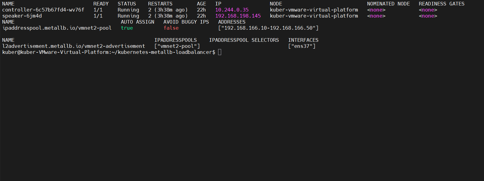
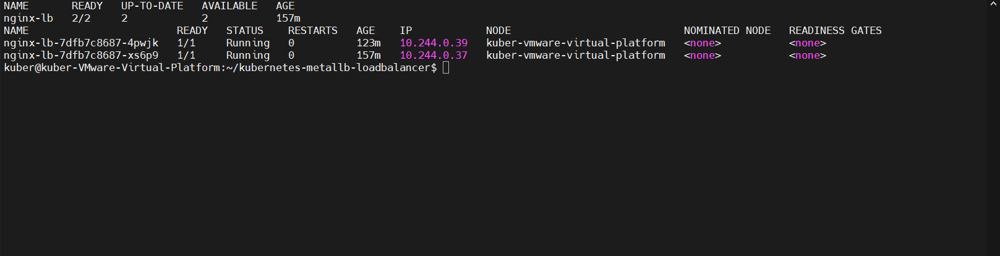
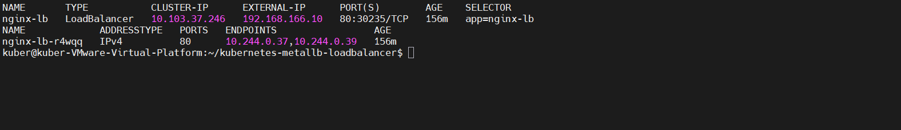
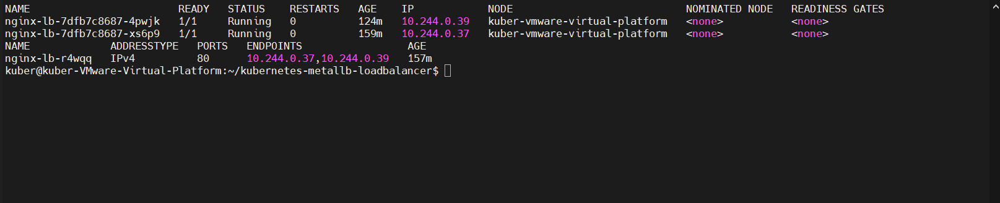

# Kubernetes LoadBalancer with MetalLB (Layer 2)

A hands-on Kubernetes networking project demonstrating how to expose an application outside a Kubernetes cluster using **MetalLB Layer 2 mode**.

The project was implemented in a VMware Ubuntu virtual machine. MetalLB provides an external IP address for a Kubernetes `LoadBalancer` Service, allowing applications running inside the cluster to be accessed directly from the Windows host through a VMware Host-only network.

## Project Overview

In a bare-metal or self-managed Kubernetes environment, `LoadBalancer` Services do not automatically receive external IP addresses from a cloud provider.

MetalLB solves this problem by providing network load-balancing functionality for Kubernetes clusters running outside supported cloud environments.

In this project, MetalLB was configured in Layer 2 mode with a dedicated IP address pool. An Nginx application was deployed with two replicas and exposed through a Kubernetes LoadBalancer Service.

The implementation demonstrates:

- MetalLB installation and configuration.
- Layer 2 IP address advertisement.
- Kubernetes Deployment and Service configuration.
- External access from a Windows host.
- Traffic distribution across multiple application Pods.
- Kubernetes Deployment self-healing after Pod deletion.

## Architecture

### Network Topology

| Component | Configuration |
|---|---|
| Host operating system | Windows |
| Virtualization | VMware |
| Kubernetes node | Ubuntu 24.04.3 LTS |
| Kubernetes version | v1.37.0 |
| Container runtime | containerd 2.2.1 |
| CNI | Flannel |
| MetalLB version | v0.15.2 |
| MetalLB mode | Layer 2 |
| Kubernetes node interface | ens37 |
| Node Host-only IP | 192.168.166.129 |
| MetalLB IP pool | 192.168.166.10–192.168.166.50 |
| Assigned external IP | 192.168.166.10 |
| Nginx Service ClusterIP | 10.103.37.246 |
| Pod network | 10.244.0.0/16 |

### Traffic Flow

```text
             Windows Host
             192.168.166.1
                   |
                   |
          VMware Host-only
              VMnet2
                   |
                   |
          Ubuntu Kubernetes Node
             192.168.166.129
                 ens37
                   |
                   |
             MetalLB Speaker
              Layer 2 Mode
                   |
                   |
          External IP Address
             192.168.166.10
                   |
                   |
          Kubernetes Service
              nginx-lb
          ClusterIP: 10.103.37.246
                   |
                   |
          Kubernetes Endpoints
             /             \
            /               \
       Nginx Pod          Nginx Pod
       10.244.0.37        10.244.0.39
```

MetalLB advertises the external IP address through Layer 2 networking on the `ens37` interface. The Kubernetes Service then directs incoming traffic to the available Nginx Pod endpoints.

## Repository Structure

```text
kubernetes-metallb-loadbalancer/
│
├── docs/
│   ├── architecture.md
│   ├── test-results.md
│   ├── metallb-pods.txt
│   ├── metallb-config.txt
│   ├── nginx-pods.txt
│   ├── nginx-service.txt
│   └── nginx-endpoints.txt
│
├── manifests/
│   ├── metallb-config.yaml
│   ├── nginx-deployment.yaml
│   └── nginx-service.yaml
│
├── screenshots/
│   ├── metallb-configuration.PNG
│   ├── nginx-deployment.PNG
│   ├── loadbalancer-service.PNG
│   ├── self-healing.PNG
│   └── .gitkeep
│
└── README.md
```

## 1. MetalLB Installation

MetalLB was installed using its official native Kubernetes manifest:

```bash
kubectl apply -f https://raw.githubusercontent.com/metallb/metallb/v0.15.2/config/manifests/metallb-native.yaml
```

The MetalLB controller and speaker components were deployed in the `metallb-system` namespace.

Due to image registry connectivity problems in the environment, the required container images were downloaded separately and imported into containerd:

```bash
sudo ctr -n k8s.io images import ~/metallb-images.tar
```

The installed images were verified with:

```bash
sudo crictl images | grep metallb
```

## 2. MetalLB Configuration

The IP address pool and Layer 2 advertisement were defined in:

`manifests/metallb-config.yaml`

```yaml
apiVersion: metallb.io/v1beta1
kind: IPAddressPool
metadata:
  name: vmnet2-pool
  namespace: metallb-system
spec:
  addresses:
    - 192.168.166.10-192.168.166.50
---
apiVersion: metallb.io/v1beta1
kind: L2Advertisement
metadata:
  name: vmnet2-advertisement
  namespace: metallb-system
spec:
  ipAddressPools:
    - vmnet2-pool
  interfaces:
    - ens37
```

The address pool provides a range of external IP addresses for Kubernetes LoadBalancer Services.

The `L2Advertisement` resource specifies that MetalLB should advertise addresses from this pool through the `ens37` network interface.

The selected IP range was kept separate from the VMware Host-only DHCP range.

Apply the configuration:

```bash
kubectl apply -f manifests/metallb-config.yaml
```

Verify the resources:

```bash
kubectl get ipaddresspools,l2advertisements -n metallb-system
```

## 3. Nginx Deployment

An Nginx Deployment was created with two replicas.

File: `manifests/nginx-deployment.yaml`

```yaml
apiVersion: apps/v1
kind: Deployment
metadata:
  name: nginx-lb
  namespace: default
spec:
  replicas: 2
  selector:
    matchLabels:
      app: nginx-lb
  template:
    metadata:
      labels:
        app: nginx-lb
    spec:
      containers:
        - name: nginx
          image: 192.168.198.140:8443/nginx:1.28-alpine
          imagePullPolicy: IfNotPresent
          ports:
            - name: http
              containerPort: 80
              protocol: TCP
```

The Deployment uses an Nginx image available in the environment's local container registry/cache.

Apply the Deployment:

```bash
kubectl apply -f manifests/nginx-deployment.yaml
```

Verify:

```bash
kubectl get deployment nginx-lb
kubectl get pods -l app=nginx-lb -o wide
```

The Deployment maintains two replicas to provide application availability and demonstrate Kubernetes self-healing.

## 4. LoadBalancer Service

The application was exposed through a Kubernetes Service of type `LoadBalancer`.

File: `manifests/nginx-service.yaml`

```yaml
apiVersion: v1
kind: Service
metadata:
  name: nginx-lb
  namespace: default
spec:
  type: LoadBalancer
  selector:
    app: nginx-lb
  ports:
    - name: http
      port: 80
      targetPort: 80
      protocol: TCP
```

Apply:

```bash
kubectl apply -f manifests/nginx-service.yaml
```

Verify:

```bash
kubectl get svc nginx-lb -o wide
```

The Service successfully received the external IP address:

```text
NAME       TYPE           CLUSTER-IP      EXTERNAL-IP      PORT(S)
nginx-lb   LoadBalancer   10.103.37.246   192.168.166.10   80:30235/TCP
```

The external IP `192.168.166.10` was allocated from the MetalLB address pool.

## 5. Testing and Validation

### External Connectivity

The application was accessed from both the Ubuntu Kubernetes node and the Windows host.

Test URL:

```text
http://192.168.166.10
```

The application returned:

```text
HTTP/1.1 200 OK
```

This confirmed that the LoadBalancer external IP was reachable from outside the Kubernetes Pod network.

### Endpoint Verification

The Service endpoints were inspected using:

```bash
kubectl get endpointslices \
  -l kubernetes.io/service-name=nginx-lb
```

Actual endpoint output:

```text
NAME             ADDRESSTYPE   PORTS   ENDPOINTS
nginx-lb-r4wqq   IPv4          80      10.244.0.37,10.244.0.39
```

Both Nginx Pods were registered as Service endpoints.

### Traffic Distribution

Multiple HTTP requests were sent to the external IP.

The Nginx container logs showed successful HTTP GET requests with status code `200` on both Pods.

This verified that traffic was reaching both application replicas through the LoadBalancer Service.

### Self-Healing Test

To test Kubernetes Deployment self-healing, one of the Nginx Pods was deliberately deleted:

```bash
kubectl delete pod nginx-lb-7dfb7c8687-pcs2z
```

The Deployment controller automatically created a replacement Pod.

Before the test, the two Pods had the following IP addresses:

```text
10.244.0.37
10.244.0.38
```

After deletion and recovery:

```text
NAME                        READY   STATUS    RESTARTS   AGE    IP
nginx-lb-7dfb7c8687-4pwjk   1/1     Running   0          124m   10.244.0.39
nginx-lb-7dfb7c8687-xs6p9   1/1     Running   0          159m   10.244.0.37
```

The replacement Pod received a new IP address, `10.244.0.39`.

The EndpointSlice was automatically updated to include the replacement Pod:

```text
NAME             ADDRESSTYPE   PORTS   ENDPOINTS
nginx-lb-r4wqq   IPv4          80      10.244.0.37,10.244.0.39
```

After recovery, 20 consecutive HTTP requests to the external IP returned HTTP 200.

The external IP address remained unchanged:

```text
192.168.166.10
```

This demonstrated that the Deployment controller restored the desired replica count and that the Service automatically adapted to the updated Pod endpoints.

## 6. Screenshots

The following screenshots document the actual deployment and testing process.

### MetalLB Configuration



### Nginx Deployment



### LoadBalancer Service



### Self-Healing Test



## 7. Key Kubernetes Concepts Demonstrated

| Component | Purpose |
|---|---|
| MetalLB | Provides LoadBalancer functionality in bare-metal Kubernetes |
| IPAddressPool | Defines available external IP addresses |
| L2Advertisement | Advertises external IP addresses over Layer 2 |
| Deployment | Maintains the desired number of application replicas |
| Pod | Runs the Nginx application container |
| Service | Exposes the application and routes traffic to matching Pods |
| EndpointSlice | Maintains the backend endpoints associated with a Service |
| Flannel | Provides Pod networking inside the Kubernetes cluster |

## 8. Technical Considerations

- The project uses MetalLB Layer 2 mode rather than BGP.
- The external IP pool is configured on the VMware Host-only network.
- The `ens33` NAT interface and existing Flannel configuration were preserved.
- The Nginx image reference is specific to the registry/cache available in this lab environment.
- The project was tested on a single-node Kubernetes cluster. It demonstrates LoadBalancer exposure and Deployment self-healing, not multi-node high availability.
- The external IP is reachable from hosts connected to the relevant Host-only network; it is not a public Internet IP.

## Conclusion

This project demonstrates how MetalLB can provide external LoadBalancer functionality in a self-managed Kubernetes environment without relying on a cloud provider.

By combining MetalLB Layer 2 advertisement, Kubernetes Services, Deployments, and EndpointSlices, an Nginx application was successfully exposed to the Windows host through a dedicated external IP address.

The final tests confirmed external connectivity, successful HTTP responses, traffic reaching both application replicas, and automatic Pod replacement after failure.

**Technologies:** Kubernetes, MetalLB, Docker/Containerd, Nginx, Flannel, Linux, VMware, YAML, Layer 2 Networking.
